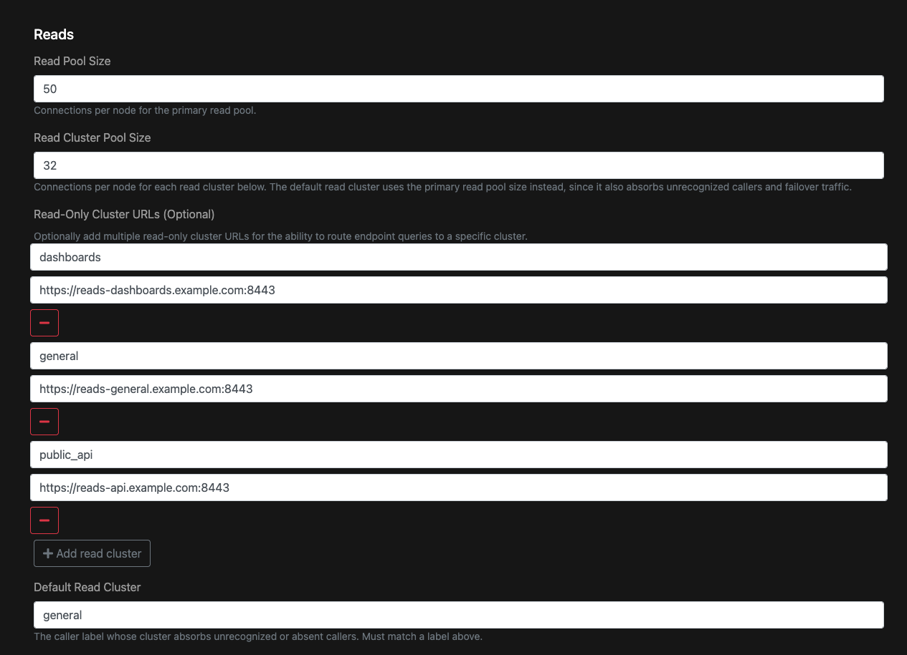
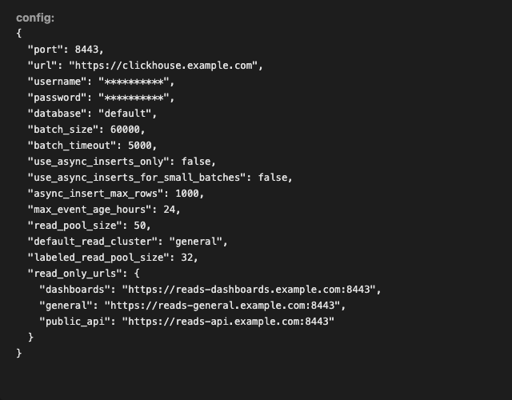

# ClickHouse

The ClickHouse backend supports both **ingestion** and **querying** via a ClickHouse [HTTP](https://clickhouse.com/docs/interfaces/http) endpoint.

## Behavior and Configuration

### Configuration

The following values are required when creating a ClickHouse backend:

- `url`: (`string`, required) a valid HTTP(S) endpoint.
- `username`: (`string`, required) used for auth.
- `password`: (`string`, required) used for auth.
- `database`: (`string`, required) the database to use.
- `port`: (`number`, required) the port to use.


### User Grants

The ClickHouse backend requires the following [user grants](https://clickhouse.com/docs/sql-reference/statements/grant):

- `INSERT`
- `SELECT`
- `CREATE TABLE`
- `ALTER TABLE`
- `DROP TABLE`,
- `CREATE VIEW`
- `DROP VIEW`

:::note
It is suggested that you create a dedicated database and user specifically for Logflare to isolate data and permissions.
:::

## Implementation Details

The ClickHouse backend will automatically attempt to provision required tables and views after receiving the first log event.

The ingest table schema is as follows:

- `id`: The log event `UUID`.
- `body`: The processed log event, stored as serialized JSON in a `String` column.
- `timestamp`: Unix microsecond, stored as `DateTime64(6)`

### Ingestion Settings

Logflare writes logs to ClickHouse asynchronously by setting `async_insert = 1` and `wait_for_async_insert = 1` on each insert operation.
Gzip compression is also applied to the data before sending to ClickHouse.

### Table Engine

By default, the ClickHouse backends will utilize the [`MergeTree` engine](https://clickhouse.com/docs/engines/table-engines/mergetree-family/mergetree).

Note that when using ClickHouse Cloud, replication is handled automatically as mentioned in the [data replication documentation](https://clickhouse.com/docs/engines/table-engines/mergetree-family/replication#creating-replicated-tables).

## Querying

ClickHouse backends support SQL querying through Logflare Endpoints and Alerts. The backend uses ClickHouse SQL dialect, which supports standard SQL features including:

- Common Table Expressions (CTEs) with `WITH` clauses
- Complex aggregations and window functions
- Array and nested data type operations
- ClickHouse-specific functions (e.g., `tuple()`, `arraySlice()`, `JSONExtractString()`)

### Sandboxed Queries

ClickHouse backends fully support [sandboxed queries](/concepts/endpoints#query-sandboxing) within Endpoints, allowing you to create secure, parameterized API endpoints where consumers can provide custom SQL while being restricted to pre-defined data subsets.

Example sandboxed ClickHouse endpoint:

```sql
WITH filtered_logs AS (
    SELECT id, event_message, timestamp
    FROM my_clickhouse_source
    WHERE timestamp > now() - interval 1 day
)
SELECT * FROM filtered_logs
```

Consumers can then query within the sandbox via the `sql=` parameter:

```sql
SELECT event_message, count(*) as count
FROM filtered_logs
GROUP BY event_message
ORDER BY count DESC
```

See the [Endpoints documentation](/concepts/endpoints) for more details on sandboxed queries and security features.

## Query Routing

Query routing is optional. By default, endpoint queries run against the backend's ClickHouse URL, which also handles ingestion, and most backends never need more than that.

Routing sends endpoint queries to dedicated read-only ClickHouse clusters based on the value of the `LF-ENDPOINT-CLICKHOUSE-READ-CLUSTER-LABEL` request header. Each read cluster is registered under a label, and a request that sends a matching label in that header runs on that cluster. Consider it when:

- Endpoint queries compete with ingestion for CPU and memory, and inserts slow down when query load rises.
- One group of callers, such as an API used by free-tier users or ad-hoc dashboard queries, runs unpredictable or expensive queries that slow down everyone else.
- Different callers need different capacity, so you want to size and scale each cluster separately.

It is suggested to start by moving only the workloads that cause contention onto their own cluster, and leave everything else on the default read cluster. You can add clusters later as you learn which callers need isolation; giving every caller its own cluster from the start adds cost without much benefit.

Read clusters must serve the same database and tables as the primary `url`, for example compute-compute separated services in ClickHouse Cloud or replicas of the same cluster.

### Configuring Read Clusters

Read clusters are added in the **Reads** section of the ClickHouse backend form. The section starts with a single empty row under **Read-Only Cluster URLs**.

1. Open the ClickHouse backend and click **edit**.
2. Scroll to the **Reads** section.
3. In the empty row, enter a label (_for example `general`_) and the URL of the read cluster, including the port.
4. Click **Add read cluster** to add another row, and repeat for each cluster you want to route to.
5. In **Default Read Cluster**, enter the label of the cluster that should serve all other requests. This field is required once any read cluster is added, and must match one of the labels from the previous steps. The default read cluster also takes over queries from any other read cluster that fails with a connection error, so size it for that extra load. See [Failover](#failover) below.
6. Optionally adjust **Read Cluster Pool Size**.
7. Click **Save changes**.



The fields in the **Reads** section are:

- **Read Pool Size**: connections per node for the primary read pool. This pool size also applies to the default read cluster.
- **Read Cluster Pool Size**: connections per node for each read cluster other than the default. Defaults to `32`.
- **Read-Only Cluster URLs**: one row per read cluster, holding a label and the cluster's HTTP(S) URL including the port. The minus button removes a row.
- **Default Read Cluster**: the label of the cluster that serves requests without a label, or with a label that is not configured. It must match one of the labels above, and the form requires it once any read cluster is configured.

Labels must be unique. Several labels can point at the same URL, which lets you give each caller its own label now and move it to a separate cluster later. The label `(unlabeled)` is reserved.

:::note
Each label gets its own connection pool on every Logflare node, even when several labels share the same read cluster URL. A cluster shared by three labels receives three pools of connections from each node: **Read Cluster Pool Size** per label, or **Read Pool Size** for the default read cluster. Pools start on a label's first query and stop after 5 minutes without queries. Account for this when sizing **Read Cluster Pool Size** and the cluster's connection limits.
:::

After saving, the backend's configuration lists the clusters under `read_only_urls` along with the `default_read_cluster`:



The same options can be set through the backends API with the `read_only_urls`, `default_read_cluster`, and `labeled_read_pool_size` config keys.

Read clusters use the query credentials when **ClickHouse Query Username** and **ClickHouse Query Password** are set, otherwise falling back to the ingest credentials. That user needs `SELECT` on every read cluster. **Test connection** on the backend page checks the `SELECT` grant on each configured read cluster.

### Routing Endpoint Queries

Send the label in the `LF-ENDPOINT-CLICKHOUSE-READ-CLUSTER-LABEL` header when querying an endpoint backed by ClickHouse:

```bash
curl "https://api.logflare.app/api/endpoints/query/my-endpoint" \
  -H 'X-API-KEY: YOUR-ACCESS-TOKEN' \
  -H 'LF-ENDPOINT-CLICKHOUSE-READ-CLUSTER-LABEL: dashboards'
```

Logflare picks the cluster for each query as follows:

1. If the header matches a configured label, the query runs on that cluster.
2. Otherwise, the query runs on the default read cluster.
3. If no default read cluster is set, the query runs on the primary `url`, the same cluster that receives ingestion.

Logflare logs a warning when a request sends a label that is not configured, unless the label is one of the query classes. The header also selects the [query-class policy](../../self-hosting/clickhouse-query-policy.md) when one is configured, even if the label has no read cluster of its own.

### Failover

If a query on a non-default read cluster fails with a connection error, such as the cluster refusing connections or a connection dropping mid-query, Logflare retries it once on the default read cluster. Other failures are returned to the caller without a retry, including ClickHouse query errors, query timeouts, and an exhausted connection pool. Queries that already run on the default read cluster are not retried, and there is no failover when no default read cluster is set.

### Modifying Read Clusters

Edit the backend and change, add, or remove rows, then save. Removing a label sends its traffic to the default read cluster until the row is restored, so callers do not need to change their headers first.

:::note
Saving a ClickHouse backend's configuration restarts its read connection pools on every Logflare node. Queries running on those pools fail and need to be retried. New pools start on the next query.
:::
